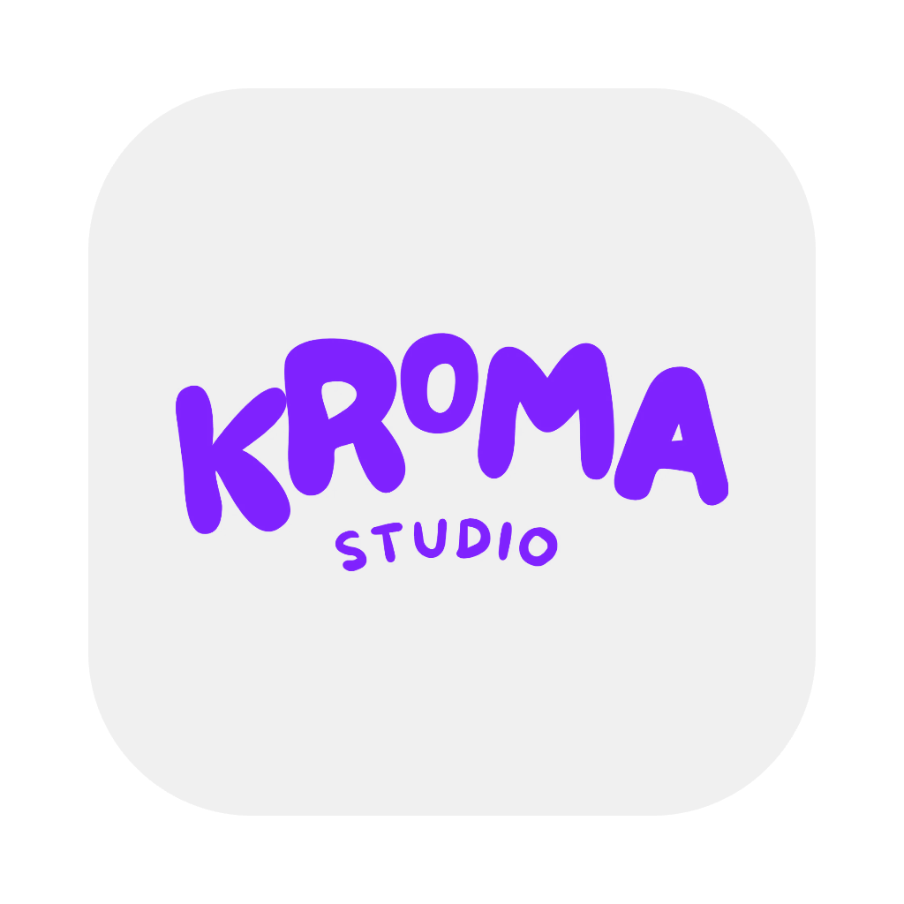
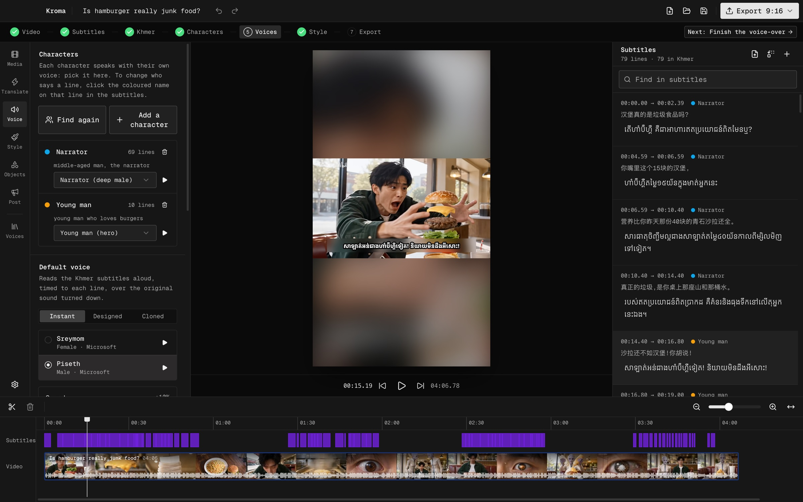
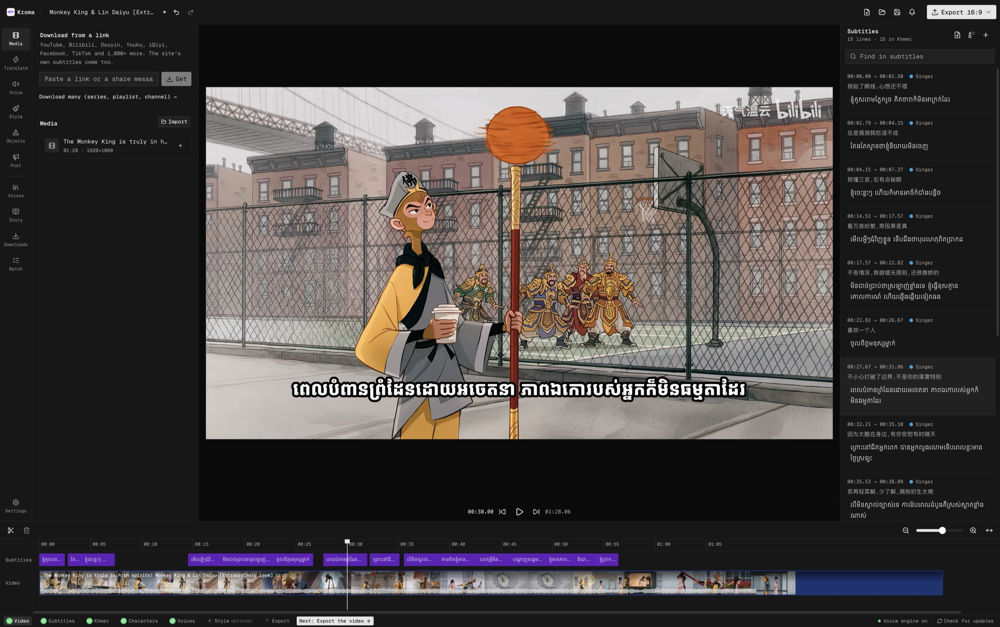
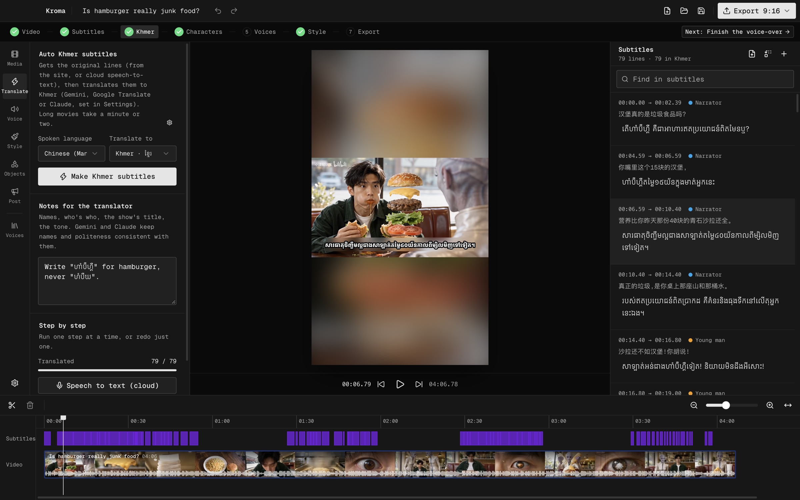
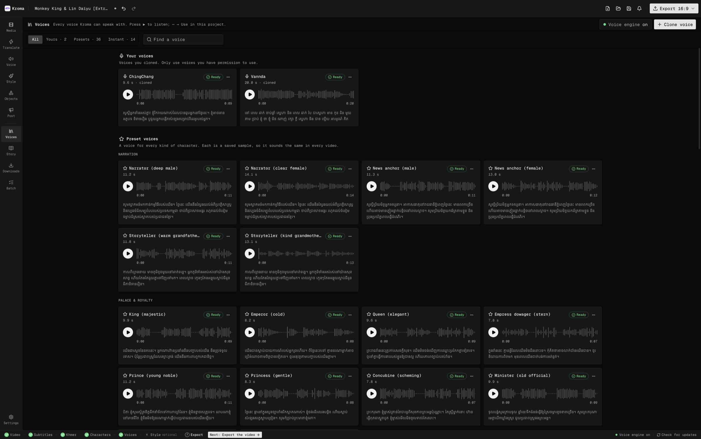
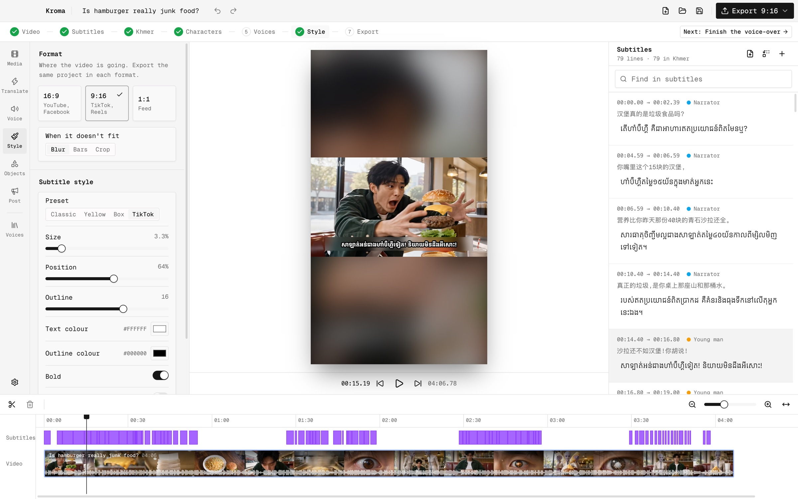
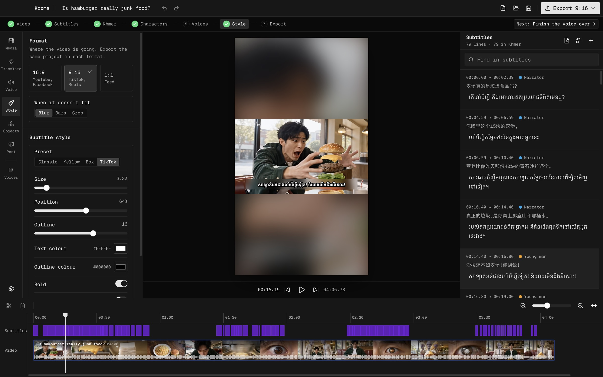
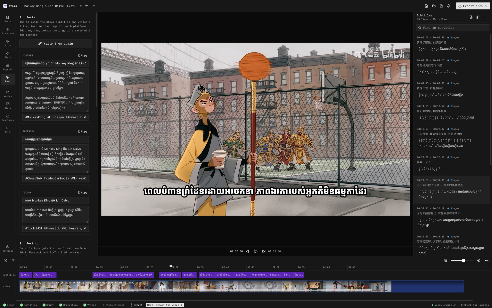

<h1 align="center">
  <a href="https://heang-dev.github.io/kroma/"></a> Kroma Studio
</h1>

<p align="center">
  <a href="https://github.com/Heang-Dev/kroma/releases/latest"></a>
  <a href="https://github.com/Heang-Dev/kroma/releases"></a>
  <a href="https://github.com/Heang-Dev/KROMA.STUDIO"></a>
  <a href="LICENSE"></a>
  <a href="https://t.me/kromastudio_community"></a>
  
</p>

<p align="center">
  <sub><b>English</b> · <a href="docs/readme/README.km.md">ខ្មែរ</a></sub>
</p>

<h2 align="center">Turn any video into a Khmer video.</h2>

<p align="center">
  Download a video or a whole series from YouTube, Bilibili, Douyin and 1,000+ sites. Get the subtitles, translate them to Khmer, give every character their own voice, and post to YouTube, Facebook and TikTok. One free, open-source desktop app.
</p>

<h3 align="center">
  <a href="https://heang-dev.github.io/kroma/download/"><ins>Download Kroma Studio</ins></a> &nbsp;·&nbsp;
  <a href="https://heang-dev.github.io/kroma/docs/"><ins>Read the docs →</ins></a>
</h3>

<p align="center">
  
</p>

## Features

<table>
<tr>
<td width="50%" valign="middle">

### Download from 1,000+ sites

Paste a link from YouTube, Bilibili, Douyin, Youku, iQiyi, Facebook or TikTok, or a whole share message. Kroma brings the site's own subtitles along when it has them. The Download Center takes a whole series, playlist or channel and makes each episode its own numbered project.

[Downloading videos →](https://heang-dev.github.io/kroma/docs/0.2/downloading/)

</td>
<td width="50%">
  
</td>
</tr>
<tr>
<td width="50%" valign="middle">

### Khmer that sounds like Khmer

Gemini (free), Google Translate (free, no key) or Claude translate the meaning the way people talk: the right politeness, common spellings for foreign words, and every line short enough to read in its time on screen. A series glossary keeps every name spelled the same in every episode. Thai, Vietnamese, Lao, English, Indonesian and Malay too.

[Translation →](https://heang-dev.github.io/kroma/docs/0.2/translation/)

</td>
<td width="50%">
  
</td>
</tr>
<tr>
<td width="50%" valign="middle">

### Every character gets a voice

Kroma reads the dialogue, works out who says each line and gives the narrator, the king and the hero each their own voice. The original voices are removed; the music and effects stay.

[Characters & voices →](https://heang-dev.github.io/kroma/docs/0.2/characters-and-voices/)

</td>
<td width="50%">
  
</td>
</tr>
<tr>
<td width="50%" valign="middle">

### 36 Khmer voices, or your own

Kings, queens, heroes, monks, villains and kids, each a saved voice that sounds the same in every video. Clone your own voice by reading a short text in the app, or use the free instant voices that need no key.

[Voice library →](https://heang-dev.github.io/kroma/voices/)

</td>
<td width="50%">
  
</td>
</tr>
<tr>
<td width="50%" valign="middle">

### Style it your way

33 subtitle styles with Khmer display fonts, shadows and glows, animated captions (fade, pop, or the spoken word lighting up), and your own saved looks. **Hide original subtitles** finds the burned-in Chinese subtitles and blurs exactly those. 16:9 for YouTube, 9:16 for TikTok and Reels, 1:1, from the same project.

[Style & objects →](https://heang-dev.github.io/kroma/docs/0.2/style-and-objects/)

</td>
<td width="50%">
  
</td>
</tr>
<tr>
<td width="50%" valign="middle">

### Post everywhere in one click

The AI writes a title, text and hashtags for each platform. Connect YouTube, Facebook and TikTok once, tick where to post, and Kroma exports the right format for each, uploads and follows each post to the end. Episode covers with the number (ភាគ ៥, EP 5) come in 16:9 and 9:16.

[Posting →](https://heang-dev.github.io/kroma/docs/0.2/posting/)

</td>
<td width="50%">
  
</td>
</tr>
</table>

## More in Kroma

- **Batch.** Add many videos at once, from the Download Center or your project files, choose the steps once (subtitles, translate, characters, voice-over, hide the original subtitles, style, export, covers, post text) and press **Process**. Each video goes through every step while you do something else, then waits in **Ready to post** so you check it first.
- **The right format for each platform.** YouTube gets 16:9; TikTok, Facebook and Reels get 9:16. Kroma exports each format it needs and uploads the right file to each platform.
- **Download Center.** Paste a whole series, a playlist or a channel, tick the episodes you want, and each video becomes its own project, numbered in a folder. The queue keeps going while you work and picks up after a restart.
- **Series glossary, my styles and episode covers.** One spelling for every name across a series, your subtitle look saved for every project, and a numbered thumbnail for every episode. [Release notes →](https://heang-dev.github.io/kroma/docs/0.2/release-notes/)
- **Story studio.** Write a story one line per speaker, give every character a voice, and Kroma reads it aloud. Save the audio with its subtitles.
- **A voice engine built in.** One button installs it on your computer, or run it on a free Google Colab GPU. [Voice engine →](https://heang-dev.github.io/kroma/docs/0.2/voice-engine/)
- **Notifications.** A bell in the title bar keeps everything that finished or failed, with **Retry** or **Open**, and your computer tells you when Kroma is in the background.

## Download

| System | File | |
| --- | --- | --- |
| **macOS** (Apple silicon, M1 and later) | `Kroma-Studio-<version>-arm64.dmg` | [Download](https://github.com/Heang-Dev/kroma/releases/latest) |
| **Windows** 10 / 11 (x64) | `Kroma-Studio-Setup-<version>.exe` | [Download](https://github.com/Heang-Dev/kroma/releases/latest) |
| **Linux** (x64) | `.AppImage` (any distro) or `.deb` (Ubuntu, Debian) | [Download](https://github.com/Heang-Dev/kroma/releases/latest) |

Kroma updates itself: new versions download in the background and a **Restart to update** card appears in the bottom-right corner. Every version and what changed in it is in the [changelog](CHANGELOG.md).

<details>
<summary><b>The installers aren't code-signed yet</b></summary>

- **macOS:** if it says the app is damaged or won't open, run this once in Terminal: `xattr -cr "/Applications/Kroma Studio.app"`
- **Windows:** on "Windows protected your PC", click **More info → Run anyway**.
- **Linux:** `chmod +x Kroma-Studio-*.AppImage`, then run it.

</details>

## How it works

| Step | How |
| --- | --- |
| Download | `yt-dlp`, with the site's own subtitles when it has them; the Download Center queues whole series, playlists and channels |
| Speech to text | Gemini (default), Groq Whisper large-v3 or OpenAI: a 5-minute video in seconds |
| Translate | Gemini (free tier), Google Translate (free, no key) or Claude; lines written to fit their time on screen |
| Characters & voices | Finds who says each line; 36 Khmer voices and voice cloning on Kroma's own voice engine (`engine/`, installed with one button or run on Google Colab), free instant voices; original voices removed with audio-separator |
| Edit | Preview, timeline (split, trim, reorder), subtitle list, 33 styles and animated captions, burned-in subtitles found and blurred, logos and text |
| Export | FFmpeg, Small / Standard / High; subtitles drawn by Chromium (correct Khmer shaping), so the export matches the preview |
| Post | AI-written titles, text and hashtags; one-click posting to YouTube, Facebook and TikTok through Upload-Post, in the right format for each (16:9 or 9:16) |
| Batch | Runs many videos through the same steps, one after another, and stops before posting; numbered covers for each episode |

The heavy AI work runs in the cloud with your own keys (many free), so long videos are fast on any computer. Your videos, projects and keys stay on your machine; keys are encrypted with your system's keychain.

## Run from source

```bash
# macOS: brew install ffmpeg yt-dlp   ·   Windows / Linux: node scripts/fetch-tools.mjs (bundles FFmpeg and yt-dlp)
bun install
bun run dev          # the editor with hot reload
bun run dist         # macOS app in dist/   ·   bun run dist:win / dist:linux on those systems
```

Open Settings (⌘, or Ctrl+,) and add a free Gemini key from [Google AI Studio](https://aistudio.google.com/apikey). It covers speech to text, translation and posts. Google Translate needs no key at all.

### Checks

```bash
bun run typecheck
bun run test
bun run build && node scripts/smoke.mjs <video.mp4> <out-dir> [--download]   # launches the app, screenshots, exports
```

Windows and Linux builds are made and smoke-tested on GitHub Actions (`.github/workflows/build.yml`).

### Project layout

- `src/main/`: Electron main process: `download.ts` (yt-dlp), `downloads.ts` (Download Center queue), `batch.ts` (Batch), `story.ts` (Story studio), `engine.ts` (the voice engine), `notify.ts` (system notifications), `transcribe.ts` (speech to text), `ai.ts` + `gemini.ts` + `google-translate.ts` (translation and posts), `voice.ts` (voice-over), `export.ts` (FFmpeg), `updater.ts` (auto-update), `settings.ts` (keys encrypted with the keychain), `index.ts` (windows, `kroma://` media protocol, IPC)
- `src/preload/`: the `window.kroma` API
- `src/renderer/src/`: the React editor. `lib/timeline.ts` (clip maths), `lib/subtitleRender.ts` (one renderer for preview and export), `lib/actions.ts`, `state/store.ts` (zustand, undo/redo)
- `src/shared/`: types, languages and SRT parsing
- `website/`: the website and docs (Next.js, static export, on the app's own design tokens). Publish with `bash website/scripts/publish.sh`.

### Design

Follows [Orca](https://github.com/stablyai/orca)'s look (MIT): shadcn/ui on Radix, Lucide icons, Orca's neutral tokens (`src/renderer/src/tokens.css`), Geist Mono, and Kantumruy Pro for Khmer. Kroma's accent is violet `#7F22FE`.

## Use it responsibly

Only download, translate and repost videos you have the right to use, and only clone voices that are your own or that you have the speaker's permission for. Videos protected with DRM can't be downloaded.

## Contributing

Questions and chat: join the [Telegram group](https://t.me/kromastudio_community).

Bug reports, ideas and fixes are welcome: [open an issue](https://github.com/Heang-Dev/KROMA.STUDIO/issues) or send a pull request.

## License

[MIT](LICENSE) © 2026 Heang-Dev
