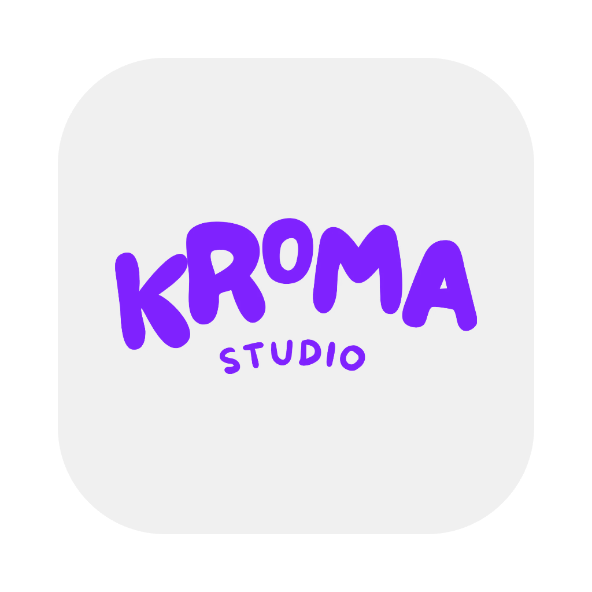
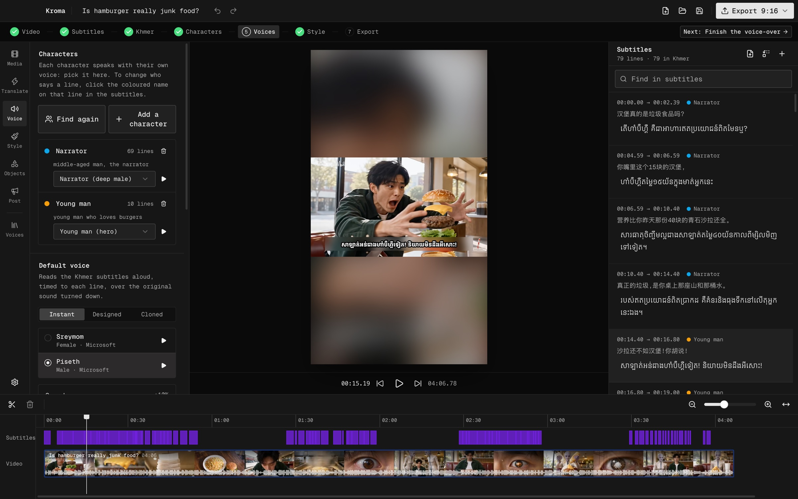
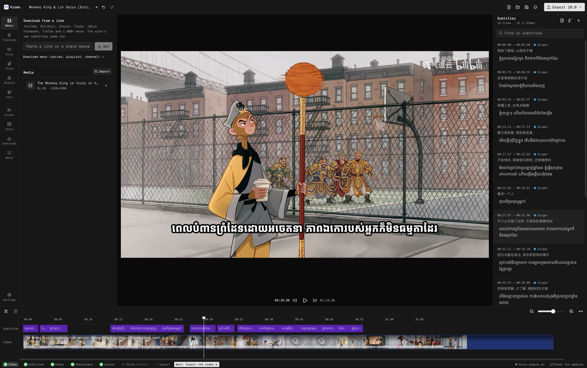
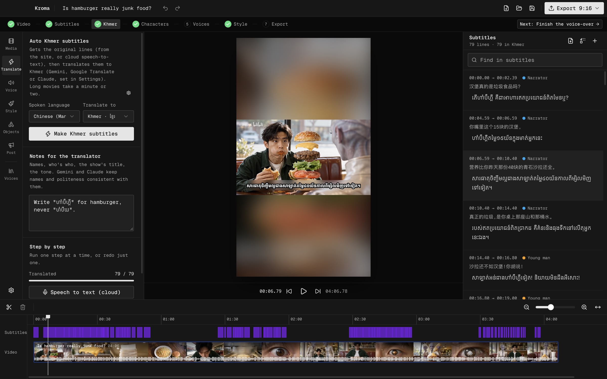
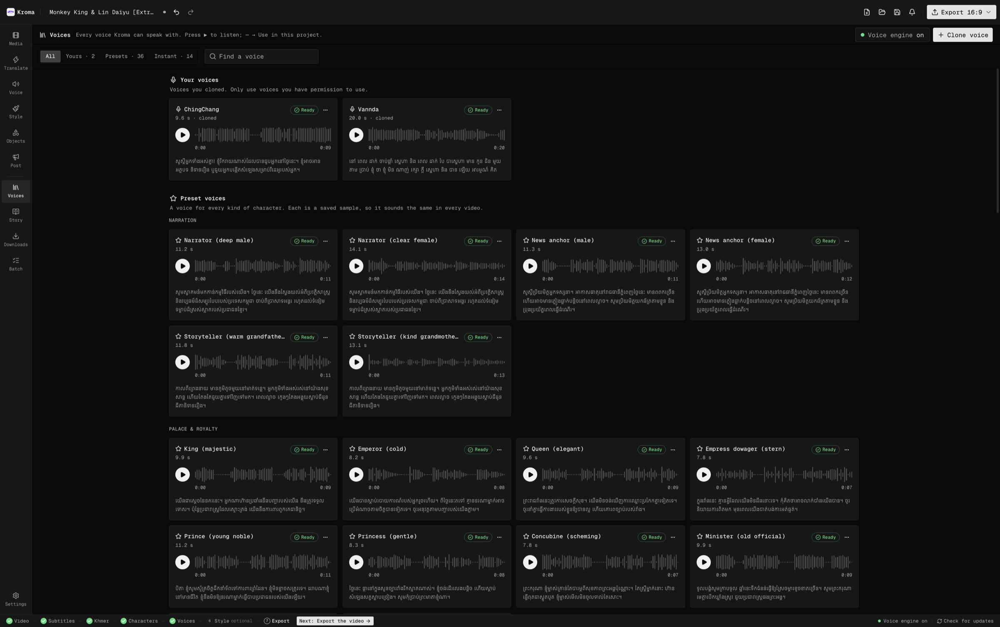
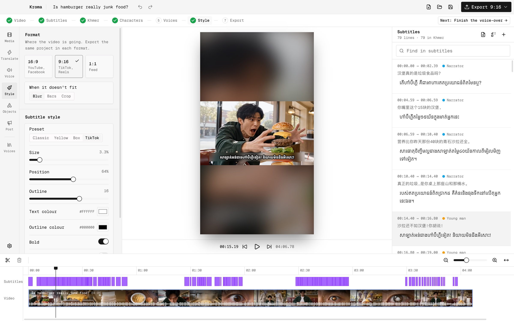
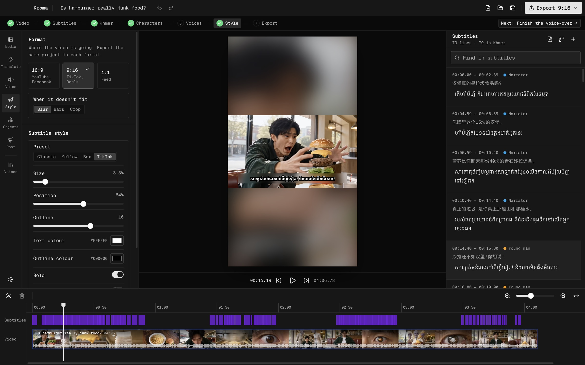
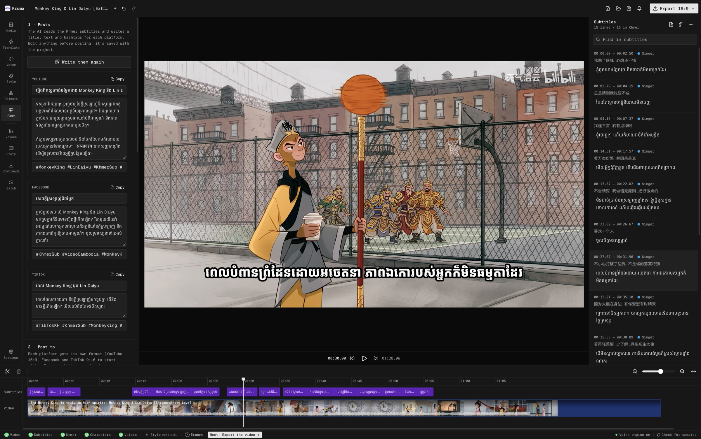

<h1 align="center">
   Kroma Studio
</h1>

  
  
  
  
  
  

  <a href="../../README.md">English</a> · <b>ខ្មែរ</b>

<h2 align="center">ប្រែវីដេអូណាមួយ ឱ្យទៅជាវីដេអូខ្មែរ។</h2>

  ទាញយកវីដេអូមួយ ឬរឿងភាគទាំងមូល ពី YouTube, Bilibili, Douyin និងគេហទំព័រជាង ១០០០។ យកអក្សររត់ បកប្រែជាភាសាខ្មែរ ផ្តល់សំឡេងផ្ទាល់ខ្លួនឱ្យតួអង្គនីមួយៗ ហើយបង្ហោះទៅ YouTube, Facebook និង TikTok។ កម្មវិធីកុំព្យូទ័រតែមួយ ឥតគិតថ្លៃ និងជាកូដបើកចំហ។

<h3 align="center">
  <a href="https://heang-dev.github.io/kroma/km/download/"><ins>ទាញយក Kroma Studio</ins></a> &nbsp;·&nbsp;
  <a href="https://heang-dev.github.io/kroma/km/docs/"><ins>អានឯកសារណែនាំ →</ins></a>
</h3>

  

## មុខងារ

<table>
<tr>
<td width="50%" valign="middle">

### ទាញយកពីគេហទំព័រជាង ១០០០

បិទភ្ជាប់តំណពី YouTube, Bilibili, Douyin, Youku, iQiyi, Facebook ឬ TikTok ឬសារចែករំលែកទាំងមូល។ Kroma យកអក្សររត់ផ្ទាល់របស់គេហទំព័រមកជាមួយ ពេលវាមាន។ Download Center ទទួលរឿងភាគ បញ្ជីចាក់ ឬឆានែលទាំងមូល ហើយធ្វើឱ្យភាគនីមួយៗក្លាយជាគម្រោងមួយដែលមានលេខរៀង។

[ការទាញយកវីដេអូ →](https://heang-dev.github.io/kroma/km/docs/0.2/downloading/)

</td>
<td width="50%">
  
</td>
</tr>
<tr>
<td width="50%" valign="middle">

### ភាសាខ្មែរដែលស្តាប់ទៅដូចខ្មែរ

Gemini (ឥតគិតថ្លៃ), Google Translate (ឥតគិតថ្លៃ គ្មាន key) ឬ Claude បកប្រែអត្ថន័យតាមរបៀបដែលមនុស្សនិយាយ៖ ពាក្យគួរសមត្រឹមត្រូវ ការសរសេរពាក្យបរទេសតាមទម្លាប់ ហើយបន្ទាត់នីមួយៗខ្លីល្មមអានទាន់ពេល។ សទ្ទានុក្រមរឿងភាគរក្សាឈ្មោះនីមួយៗឱ្យសរសេរដូចគ្នាគ្រប់ភាគ។ មានភាសាថៃ វៀតណាម ឡាវ អង់គ្លេស ឥណ្ឌូនេស៊ី និងម៉ាឡេផងដែរ។

[ការបកប្រែ →](https://heang-dev.github.io/kroma/km/docs/0.2/translation/)

</td>
<td width="50%">
  
</td>
</tr>
<tr>
<td width="50%" valign="middle">

### តួអង្គនីមួយៗមានសំឡេងផ្ទាល់ខ្លួន

Kroma អានការសន្ទនា រកថាអ្នកណានិយាយបន្ទាត់នីមួយៗ ហើយផ្តល់សំឡេងដាច់ដោយឡែកដល់អ្នកនិទានរឿង ស្តេច និងវីរបុរស។ សំឡេងដើមត្រូវបានដកចេញ ចំណែកតន្ត្រី និងបែបផែនសំឡេងនៅដដែល។

[តួអង្គ និងសំឡេង →](https://heang-dev.github.io/kroma/km/docs/0.2/characters-and-voices/)

</td>
<td width="50%">
  
</td>
</tr>
<tr>
<td width="50%" valign="middle">

### សំឡេងខ្មែរ ៣៦ ឬសំឡេងរបស់អ្នក

ស្តេច មហាក្សត្រី វីរបុរស ព្រះសង្ឃ តួអាក្រក់ និងកុមារ សំឡេងនីមួយៗស្តាប់ទៅដូចគ្នាក្នុងគ្រប់វីដេអូ។ ចម្លងសំឡេងរបស់អ្នក ដោយអានអត្ថបទខ្លីមួយក្នុងកម្មវិធី ឬប្រើសំឡេងរហ័សឥតគិតថ្លៃ ដែលមិនត្រូវការ key។

[បណ្ណាល័យសំឡេង →](https://heang-dev.github.io/kroma/km/voices/)

</td>
<td width="50%">
  
</td>
</tr>
<tr>
<td width="50%" valign="middle">

### រចនាតាមចិត្តអ្នក

រចនាប័ទ្មអក្សររត់ 33 ជាមួយពុម្ពអក្សរខ្មែរ ស្រមោល និងពន្លឺ អក្សររត់មានចលនា (លេចបន្តិចម្តងៗ លោតចូល ឬពាក្យដែលកំពុងនិយាយភ្លឺឡើង) និងរូបរាងដែលអ្នករក្សាទុកខ្លួនឯង។ **Hide original subtitles** រកអក្សររត់ចិនដែលដិតជាប់ ហើយធ្វើឱ្យព្រិលត្រូវតែកន្លែងនោះ។ 16:9 សម្រាប់ YouTube, 9:16 សម្រាប់ TikTok និង Reels, 1:1 ពីគម្រោងតែមួយ។

[រចនាប័ទ្ម និងវត្ថុ →](https://heang-dev.github.io/kroma/km/docs/0.2/style-and-objects/)

</td>
<td width="50%">
  
</td>
</tr>
<tr>
<td width="50%" valign="middle">

### បង្ហោះគ្រប់កន្លែងដោយចុចតែម្តង

AI សរសេរចំណងជើង អត្ថបទ និង hashtag សម្រាប់វេទិកានីមួយៗ។ ភ្ជាប់ YouTube, Facebook និង TikTok តែម្តង ជ្រើសកន្លែងបង្ហោះ ហើយ Kroma នាំចេញទម្រង់ត្រឹមត្រូវសម្រាប់វេទិកានីមួយៗ ផ្ទុកឡើង និងតាមដានការបង្ហោះនីមួយៗរហូតដល់ចប់។ គម្របភាគដែលមានលេខ (ភាគ ៥, EP 5) មានទាំង 16:9 និង 9:16។

[ការបង្ហោះ →](https://heang-dev.github.io/kroma/km/docs/0.2/posting/)

</td>
<td width="50%">
  
</td>
</tr>
</table>

## មុខងារផ្សេងទៀតក្នុង Kroma

- **Batch។** បន្ថែមវីដេអូច្រើនក្នុងពេលតែមួយ ពី Download Center ឬឯកសារគម្រោងរបស់អ្នក ជ្រើសជំហានតែម្តង (អក្សររត់ បកប្រែ តួអង្គ សំឡេង លាក់អក្សររត់ដើម រចនាប័ទ្ម នាំចេញ គម្រប អត្ថបទបង្ហោះ) ហើយចុច **Process**។ វីដេអូនីមួយៗឆ្លងកាត់គ្រប់ជំហាន ខណៈពេលអ្នកធ្វើការងារផ្សេង រួចរង់ចាំក្នុង **Ready to post** ដើម្បីឱ្យអ្នកពិនិត្យមុនសិន។
- **ទម្រង់ត្រឹមត្រូវសម្រាប់វេទិកានីមួយៗ។** YouTube ទទួល 16:9 ចំណែក TikTok, Facebook និង Reels ទទួល 9:16។ Kroma នាំចេញទម្រង់នីមួយៗដែលត្រូវការ ហើយផ្ទុកឡើងឯកសារត្រឹមត្រូវទៅវេទិកានីមួយៗ។
- **Download Center។** បិទភ្ជាប់រឿងភាគទាំងមូល បញ្ជីចាក់ ឬឆានែល ជ្រើសភាគដែលអ្នកចង់បាន ហើយវីដេអូនីមួយៗក្លាយជាគម្រោងដាច់ដោយឡែក មានលេខរៀងក្នុងថតមួយ។ ជួរទាញយកបន្តដំណើរការ ខណៈពេលអ្នកធ្វើការ ហើយបន្តពីកន្លែងចាស់ក្រោយបើកកម្មវិធីឡើងវិញ។
- **សទ្ទានុក្រមរឿងភាគ រចនាប័ទ្មរបស់ខ្ញុំ និងគម្របភាគ។** ការសរសេរតែមួយសម្រាប់ឈ្មោះនីមួយៗពេញរឿងភាគ រូបរាងអក្សររត់របស់អ្នកសម្រាប់គ្រប់គម្រោង និងរូបគម្របមានលេខសម្រាប់គ្រប់ភាគ។ [កំណត់ចំណាំកំណែ →](https://heang-dev.github.io/kroma/km/docs/0.2/release-notes/)
- **Story studio។** សរសេររឿងមួយបន្ទាត់សម្រាប់អ្នកនិយាយម្នាក់ ផ្តល់សំឡេងឱ្យតួអង្គនីមួយៗ ហើយ Kroma អានវាឮៗ។ រក្សាទុកសំឡេងជាមួយអក្សររត់របស់វា។
- **ម៉ាស៊ីនសំឡេងនៅក្នុងកម្មវិធីស្រាប់។** ចុចប៊ូតុងតែមួយដើម្បីដំឡើងវានៅលើកុំព្យូទ័ររបស់អ្នក ឬដំណើរការវាលើ GPU ឥតគិតថ្លៃរបស់ Google Colab។ [ម៉ាស៊ីនសំឡេង →](https://heang-dev.github.io/kroma/km/docs/0.2/voice-engine/)
- **ការជូនដំណឹង។** កណ្ដឹងនៅរបារចំណងជើង រក្សាទុកការងារទាំងអស់ដែលបានបញ្ចប់ ឬបរាជ័យ ជាមួយ **Retry** ឬ **Open** ហើយកុំព្យូទ័ររបស់អ្នកប្រាប់អ្នក ពេល Kroma កំពុងដំណើរការនៅពីក្រោយ។

## ទាញយក

| ប្រព័ន្ធ | ឯកសារ | |
| --- | --- | --- |
| **macOS** (Apple silicon, M1 ឡើងទៅ) | `Kroma-Studio-<version>-arm64.dmg` | [ទាញយក](https://github.com/Heang-Dev/kroma/releases/latest) |
| **Windows** 10 / 11 (x64) | `Kroma-Studio-Setup-<version>.exe` | [ទាញយក](https://github.com/Heang-Dev/kroma/releases/latest) |
| **Linux** (x64) | `.AppImage` (គ្រប់ distro) ឬ `.deb` (Ubuntu, Debian) | [ទាញយក](https://github.com/Heang-Dev/kroma/releases/latest) |

Kroma ធ្វើបច្ចុប្បន្នភាពខ្លួនឯង៖ កំណែថ្មីទាញយកនៅពីក្រោយ ហើយប្រអប់ **Restart to update** លេចឡើងនៅជ្រុងខាងក្រោមស្តាំ។ កំណែនីមួយៗ និងអ្វីដែលបានផ្លាស់ប្តូរ មាននៅក្នុង [កំណត់ត្រាការផ្លាស់ប្តូរ](../../CHANGELOG.md) (ជាភាសាអង់គ្លេស)។

<b>កម្មវិធីដំឡើងមិនទាន់មានហត្ថលេខានៅឡើយទេ</b>

- **macOS:** បើវាបង្ហាញថាកម្មវិធីខូច ឬបើកមិនកើត សូមដំណើរការម្តងក្នុង Terminal៖ `xattr -cr "/Applications/Kroma Studio.app"`
- **Windows:** ពេលឃើញ «Windows protected your PC» ចុច **More info → Run anyway**។
- **Linux:** `chmod +x Kroma-Studio-*.AppImage` រួចដំណើរការវា។

## ប្រើប្រាស់ដោយទទួលខុសត្រូវ

ទាញយក បកប្រែ និងបង្ហោះឡើងវិញ តែវីដេអូដែលអ្នកមានសិទ្ធិប្រើប៉ុណ្ណោះ ហើយចម្លងតែសំឡេងរបស់អ្នក ឬសំឡេងអ្នកដែលបានយល់ព្រម។ វីដេអូដែលការពារដោយ DRM មិនអាចទាញយកបានទេ។

## ការរួមចំណែក

សួរសំណួរ និងជជែក៖ ចូលរួម [ក្រុម Telegram](https://t.me/kromastudio_community)។

យើងស្វាគមន៍ការរាយការណ៍បញ្ហា គំនិត និងការកែលម្អ៖ [បើក issue](https://github.com/Heang-Dev/KROMA.STUDIO/issues) ឬផ្ញើ pull request។

## អាជ្ញាប័ណ្ណ

[MIT](../../LICENSE) © 2026 Heang-Dev
